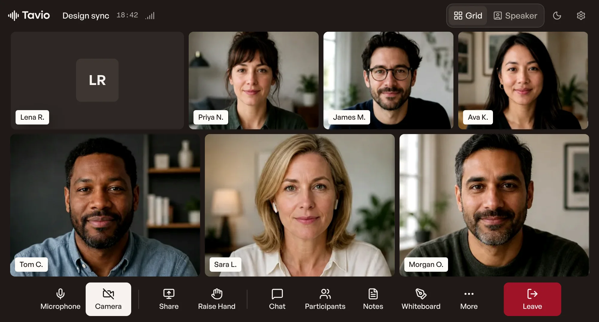
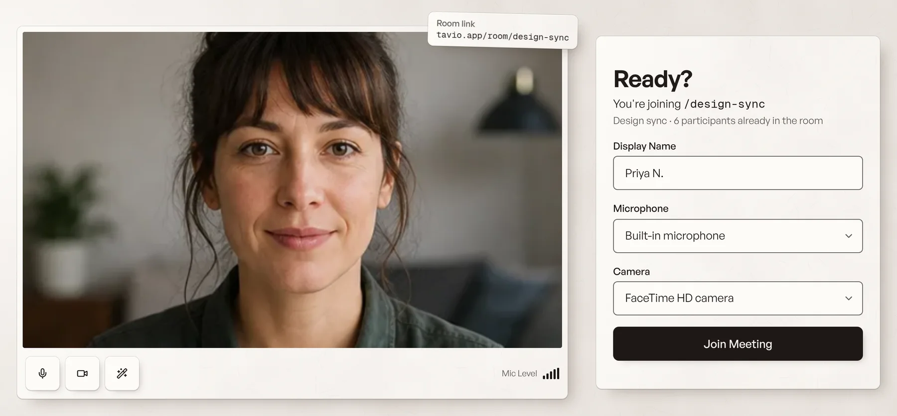
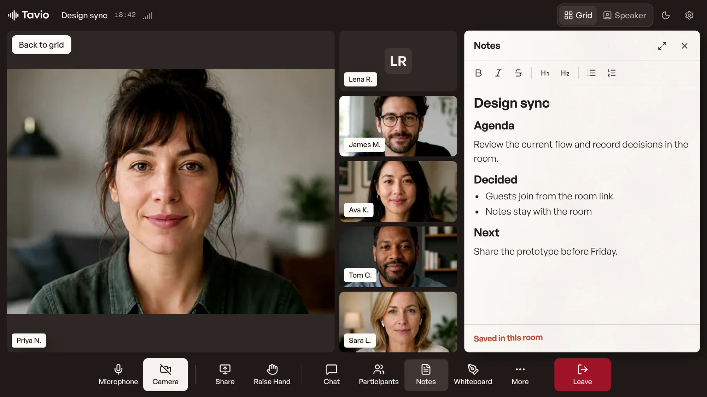
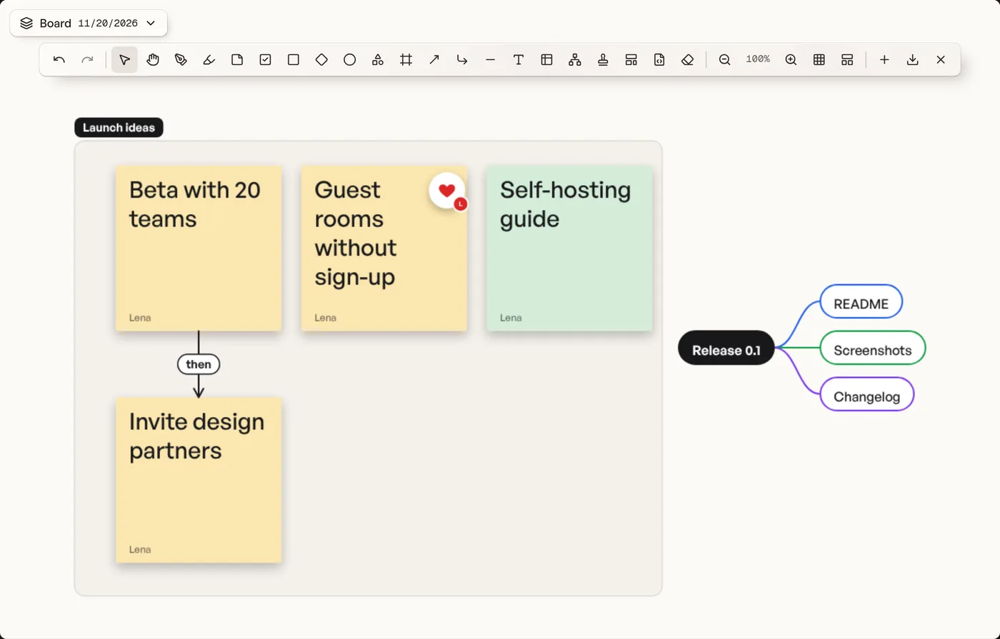
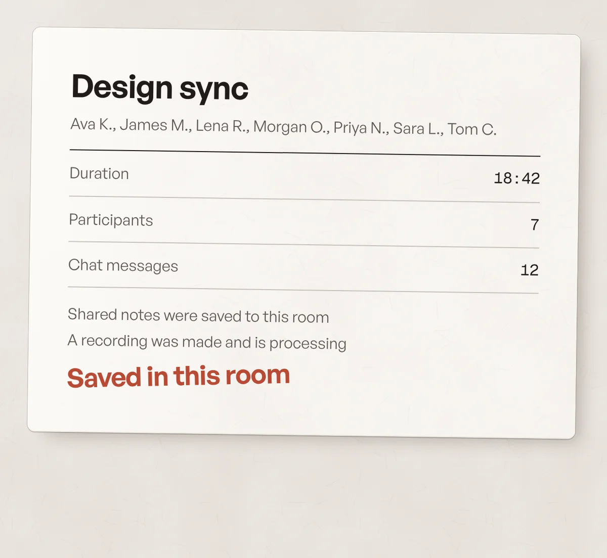

<p align="center">
  <picture>
    <source media="(prefers-color-scheme: dark)" srcset="assets/tavio-logo-light.svg">
    
  </picture>
</p>

<p align="center">
  Video meetings in the browser, with notes, whiteboard and recording in the same room.<br>
  Guests join from a link, with no account and nothing to install.
</p>

<p align="center">
  <a href="LICENSE"></a>
  <a href="https://github.com/bl4ckh4nd/tavio/releases"></a>
  <a href="https://github.com/bl4ckh4nd/tavio/actions/workflows/test.yml"></a>
</p>



Tavio is a meeting room that stays. The call runs on [LiveKit](https://livekit.io); everything that should outlast it (notes, the whiteboard, chat, recordings, transcripts and permissions) lives in [Convex](https://www.convex.dev). Run both yourself, or use LiveKit Cloud and Convex Cloud.

## Features

**Calls**
- Video, audio and screen sharing over WebRTC (LiveKit SFU), grid and speaker layouts
- Background blur and replacement in the browser (MediaPipe)
- Raise hand, participant list, connection diagnostics
- Move a running call to your phone by scanning a QR code
- Breakout rooms, and "End for all" for hosts

**Working together**
- Shared notes with a rich-text editor (TipTap) that merges edits from several people
- A whiteboard with sticky notes, shapes, connectors, sections, tables, mind maps, stamps and templates, live cursors and cursor chat, SVG and PNG export
- Facilitation on the board: timer, dot voting, comment pins and tasks
- Chat with emoji, GIFs (optional) and file uploads
- Each session keeps its board, notes and chat, so you can return to them later

**After the call**
- Server-side recording through LiveKit Egress, stored in any S3-compatible bucket
- Transcripts through Deepgram, with language detection
- An end-of-call summary: duration, participants, notes and recording

**Meeting assistant (optional)**
- Vivo joins the call when you ask for it. Say "Vivo, …" and it writes to the notes, adds tasks or draws on the whiteboard; every change can be undone. It runs as a separate Python worker in [`agent/`](agent) and works with any OpenAI-compatible model.

**Rooms and access**
- Rooms are open, password-protected or members-only; guests always pass a lobby with a camera and microphone check
- Workspaces with owners, admins and members, per-room roles, and an admin area for rooms, members and recordings
- Sign-in with email and password, GitHub or Google (Better Auth)
- English, German, Spanish and French; light and dark theme

**Integrations**
- A REST API with workspace API keys (Settings → API): create, list and delete rooms, list sessions, and fetch recordings with their transcripts. The in-app docs at `/docs` describe every endpoint.

## Screenshots

| Lobby | Notes during a call |
| --- | --- |
|  |  |

| Whiteboard | End of the call |
| --- | --- |
|  |  |

## Quick start

You need Node.js 24, [pnpm](https://pnpm.io), a [Convex](https://www.convex.dev) account (or a self-hosted Convex backend) and a LiveKit server or [LiveKit Cloud](https://cloud.livekit.io) project.

```bash
git clone https://github.com/bl4ckh4nd/tavio.git
cd tavio
pnpm install
cp .env.example .env.local
```

Fill in the Convex and LiveKit values in `.env.local`, then set the backend settings in Convex. Replace the `YOUR_…` values with your own:

```bash
npx convex env set SITE_URL http://localhost:3333
npx convex env set BETTER_AUTH_SECRET "$(openssl rand -hex 32)"
npx convex env set LIVEKIT_API_KEY YOUR_LIVEKIT_API_KEY
npx convex env set LIVEKIT_API_SECRET YOUR_LIVEKIT_API_SECRET
npx convex env set LIVEKIT_HOST wss://YOUR_LIVEKIT_HOST
```

Start the backend and the app in two terminals:

```bash
npx convex dev
pnpm dev
```

The app runs at http://localhost:3333.

### Try it with Docker

`docker-compose.yml` starts everything on one machine: a self-hosted Convex backend with its dashboard, LiveKit in dev mode, and the web app at http://localhost:3000.

```bash
docker compose up -d --build
```

The functions still have to be pushed once. The steps are in the in-app docs at `/docs#docker`. The trial uses sample secrets and is not meant for production.

## Configuration

Build-time settings go into `.env.local`; backend settings are set with `npx convex env set`. [`.env.example`](.env.example) explains each variable.

| Feature | Variables (Convex) |
| --- | --- |
| Calls (required) | `LIVEKIT_API_KEY`, `LIVEKIT_API_SECRET`, `LIVEKIT_HOST` |
| Sign-in (required) | `SITE_URL`, `BETTER_AUTH_SECRET` |
| Recording | `LIVEKIT_EGRESS_HOST`, `LIVEKIT_EGRESS_WEBHOOK_URL`, `R2_*` (any S3-compatible storage) |
| Transcripts | `DEEPGRAM_API_KEY` |
| Email (password reset, verification) | `RESEND_API_KEY`, `RESEND_FROM_EMAIL` (a sender on a domain verified in Resend) |
| GitHub / Google sign-in | `GITHUB_CLIENT_ID`, `GITHUB_CLIENT_SECRET`, `GOOGLE_CLIENT_ID`, `GOOGLE_CLIENT_SECRET` |
| Paid plans | `STRIPE_SECRET_KEY`, `STRIPE_PRICE_PRO`, `STRIPE_WEBHOOK_SECRET` |
| Meeting assistant | `ASSISTANT_AGENT_NAME`, plus the worker's own settings in [`agent/.env.example`](agent/.env.example) |
| Chat GIFs | `VITE_KLIPY_API_KEY` (build time, in `.env.local`) |

Browsers only allow camera and microphone on HTTPS or localhost, so a public deployment needs TLS.

## Deployment

The web app builds to static files (`pnpm build` → `dist/`), so any static host works. The repository includes two setups:

- **Cloudflare Workers + Convex Cloud:** `wrangler.toml` serves `dist/` with an HTTPS redirect, and [`.github/workflows/deploy.yml`](.github/workflows/deploy.yml) deploys Convex first and the frontend second on every push to `main`. Set the repository variables `PUBLIC_SITE`, `CONVEX_SITE_URL` and `CLOUDFLARE_ACCOUNT_ID` and the secrets `CONVEX_DEPLOY_KEY` and `CLOUDFLARE_API_TOKEN`; without `PUBLIC_SITE` the workflow skips the deploy. Change the domain in `wrangler.toml` to yours.
- **Docker:** [`deploy/Dockerfile`](deploy/Dockerfile) builds the app into an nginx image. Build it from the repository root with your Convex URLs and a version label: `docker build -f deploy/Dockerfile --build-arg VITE_CONVEX_URL=https://<deployment>.convex.cloud --build-arg VITE_CONVEX_SITE_URL=https://<deployment>.convex.site --build-arg DEPLOYMENT_SHA=$(git rev-parse HEAD) .` [`deploy/docker-compose.deploy.yml`](deploy/docker-compose.deploy.yml) runs the media side: LiveKit with TURN over TLS, Egress for recordings, and Redis. It expects a Traefik proxy in front and the variables `LIVEKIT_API_KEY`, `LIVEKIT_API_SECRET`, `TURN_DOMAIN`, `TURN_PEER_CIDR` and `REDIS_PASSWORD`. `TURN_PEER_CIDR` is the subnet of the stack's Docker network (`docker network inspect`). Everyone in a call can relay to that network over TURN, so keep only this stack on it; `REDIS_PASSWORD` (for example `openssl rand -hex 32`; no single quotes) keeps Redis closed to them.

The meeting assistant is a separate container: build [`agent/Dockerfile`](agent/Dockerfile) and give it the variables from `agent/.env.example`.

## Architecture

```
Browser (React 19, Vite, TanStack Router)
  │  media: WebRTC                    │  data: live queries and mutations
  ▼                                   ▼
LiveKit SFU ── Egress ──▶ S3     Convex (rooms, notes, board, chat, auth, permissions)
  ▲                                   ▲
  └──────── Vivo worker (Python, optional) ────────┘
```

LiveKit carries what is live: tracks, screen sharing and who is in the call. Convex holds what lasts, and checks every read and write against the room's access rules. Convex mints the short-lived LiveKit tokens, so nobody joins a call without passing those rules. [`docs/CONTEXT.md`](docs/CONTEXT.md) defines the domain terms, [`docs/DESIGN.md`](docs/DESIGN.md) the design system.

```
src/        web app: views/ (one per route), components/, hooks/, app-state/, lib/, styles/, locales/
convex/     backend: schema, queries, mutations, actions, HTTP routes (REST API, auth)
agent/      the optional meeting assistant (Python)
worker/     Cloudflare Worker that serves the built app
deploy/     Dockerfile, nginx config and the Docker Compose file for the media stack
tests/      Playwright end-to-end tests and shared test helpers
docs/       domain terms, design system, end-to-end test setup
```

## Development

```bash
pnpm test                 # Vitest: frontend and Convex functions
pnpm exec tsc --noEmit    # type check
pnpm e2e                  # Playwright, see docs/E2E.md
pnpm i18n                 # extract and compile translations
cd agent && .venv/bin/python -m pytest   # assistant worker
```

[`docs/E2E.md`](docs/E2E.md) explains the local stack for end-to-end tests (`pnpm e2e:local:up`).

## Contributing

Bug reports, ideas and pull requests are welcome. Read [CONTRIBUTING.md](CONTRIBUTING.md) first. Report security problems privately as described in [SECURITY.md](SECURITY.md).

## License

Tavio is licensed under the [Functional Source License, Version 1.1, ALv2 Future License](LICENSE) (FSL-1.1-ALv2), the license Convex uses for its backend. You may use, change and self-host Tavio for any purpose other than a competing use, as defined in the license. Two years after each release, that release is also available under the Apache License 2.0.

General Sans is not part of this repository: its licence does not allow redistribution, so `scripts/fetch-fonts.mjs` downloads it during `pnpm dev` and `pnpm build`.

## Acknowledgments

Built on [LiveKit](https://livekit.io), [Convex](https://www.convex.dev), [Better Auth](https://better-auth.com), [TipTap](https://tiptap.dev), [Lingui](https://lingui.dev), [MediaPipe](https://ai.google.dev/edge/mediapipe) and [Lucide](https://lucide.dev).
